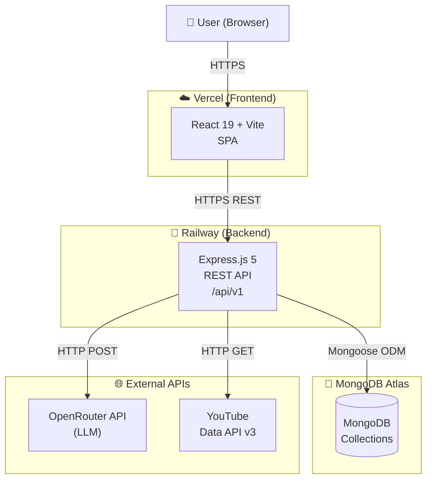
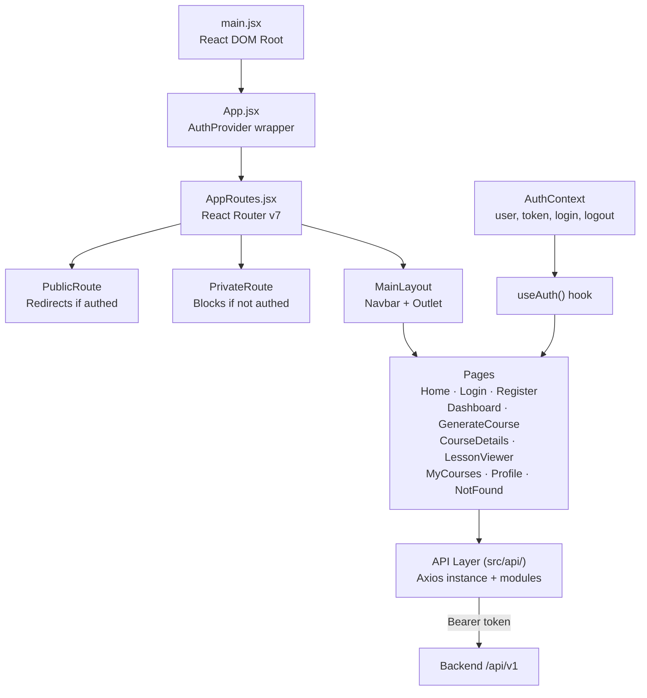
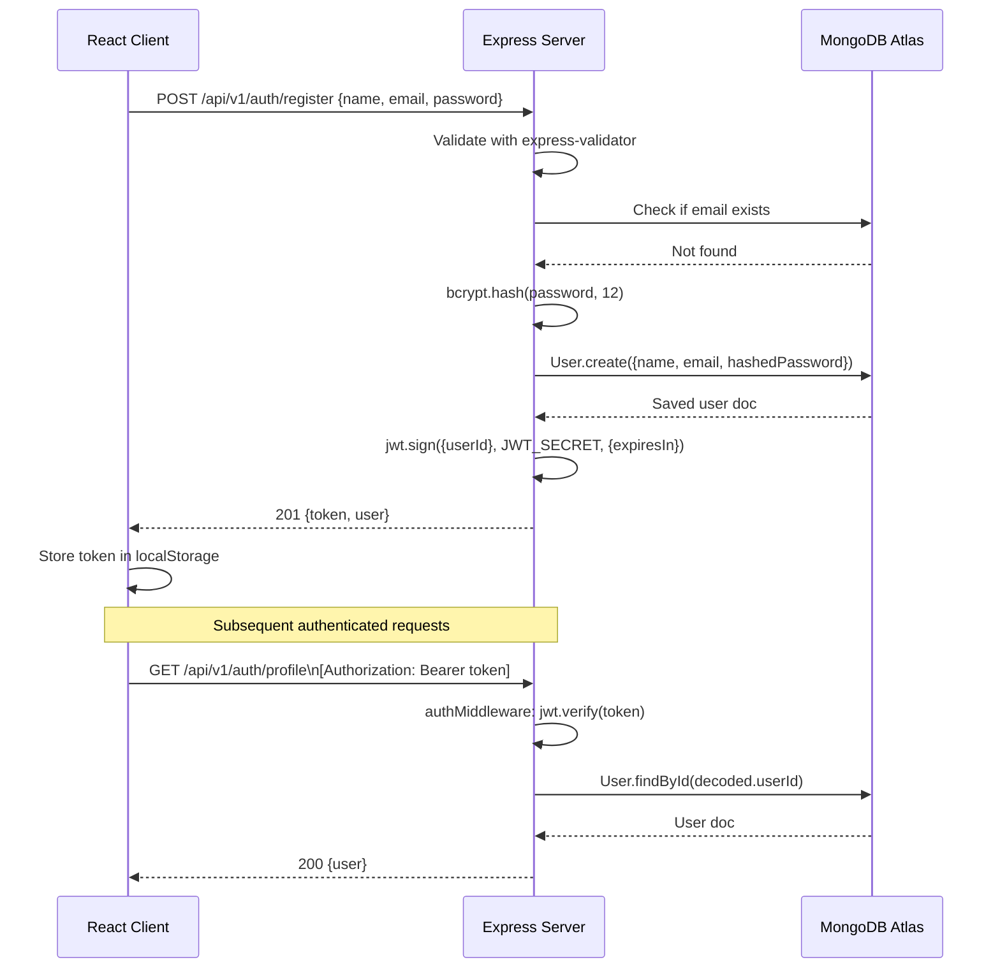
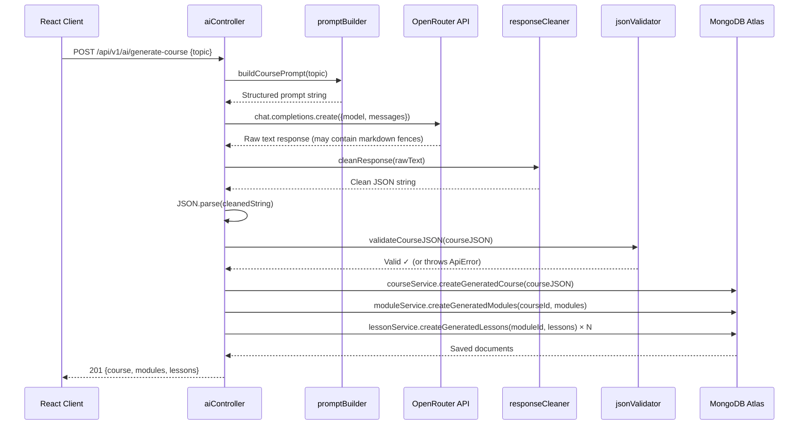
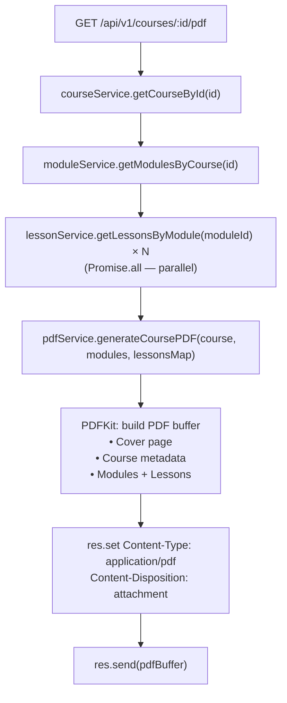
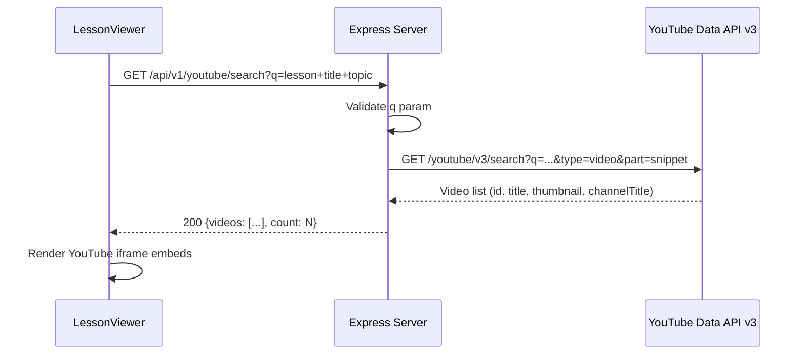
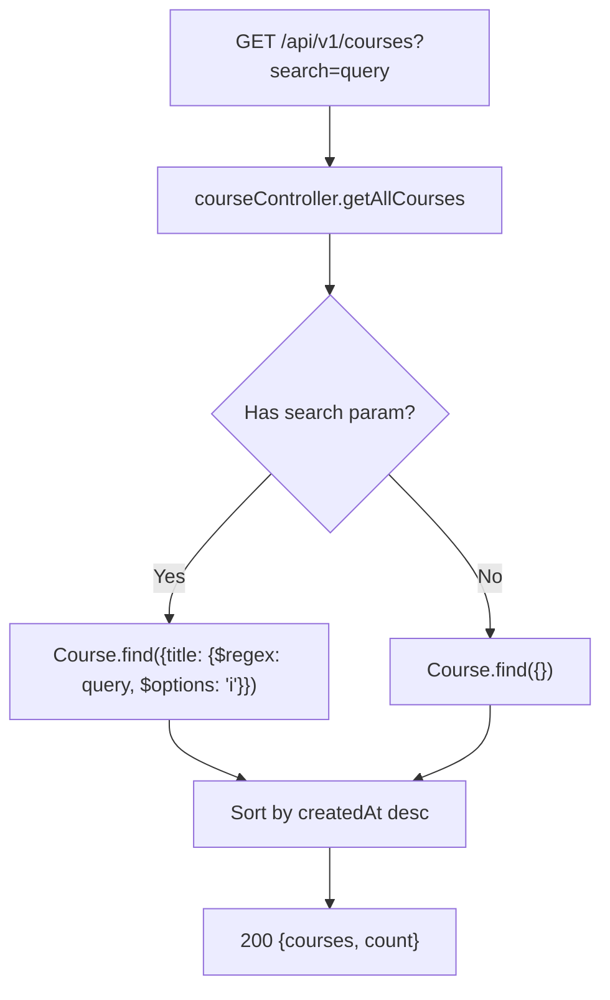
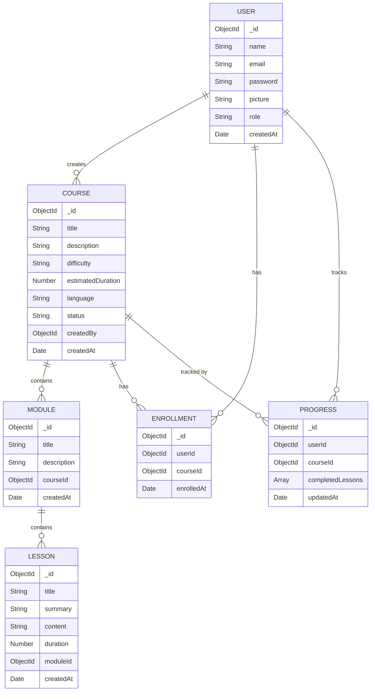
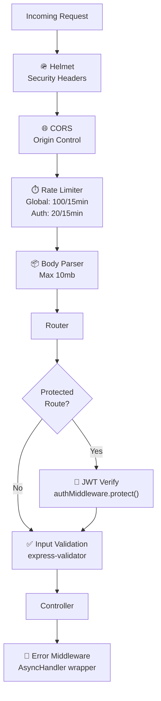

# Architecture — Text-to-Learn

This document describes the technical architecture of the Text-to-Learn platform.

---

## Overview

Text-to-Learn follows a classic **three-tier architecture**:

1. **Presentation Layer** — React + Vite SPA hosted on Vercel
2. **Application Layer** — Express.js REST API hosted on Railway
3. **Data Layer** — MongoDB Atlas (cloud-hosted NoSQL database)

External services (OpenRouter AI, YouTube Data API) are consumed exclusively by the backend.

---

## System Architecture Diagram



---

## Frontend Architecture



### Key Frontend Patterns

| Pattern | Implementation |
|---|---|
| **Auth State** | React Context + localStorage persistence |
| **Route Protection** | `PrivateRoute` / `PublicRoute` wrappers |
| **API Calls** | Centralized Axios instance with auth interceptor |
| **Notifications** | `react-hot-toast` for success/error feedback |
| **Layout** | `MainLayout` wraps all authenticated pages with `Navbar` |

---

## Backend Architecture

```mermaid
graph LR
    Request["HTTP Request"]

    subgraph Middleware["Middleware Chain"]
        Helmet["helmet()"]
        CORS["cors()"]
        RateLimit["express-rate-limit"]
        Morgan["morgan()"]
        JSON["express.json()"]
        AuthMW["authMiddleware\nprotect()"]
        Validate["validationMiddleware"]
    end

    subgraph Routes["Routes /api/v1"]
        AuthR["/auth"]
        AIR["/ai"]
        CourseR["/courses"]
        ModuleR["/modules"]
        LessonR["/lessons"]
        EnrollR["/enrollments"]
        ProgressR["/progress"]
    end

    subgraph Controllers["Controllers"]
        AuthC["authController"]
        AIC["aiController"]
        CourseC["courseController"]
    end

    subgraph Services["Services"]
        UserS["userService"]
        GeminiS["geminiService"]
        CourseS["courseService"]
        PDFS["pdfService"]
        YTS["youtubeService"]
    end

    subgraph Models["Mongoose Models"]
        UserM["User"]
        CourseM["Course"]
        ModuleM["Module"]
        LessonM["Lesson"]
        EnrollM["Enrollment"]
        ProgressM["Progress"]
    end

    Request --> Middleware
    Middleware --> Routes
    Routes --> Controllers
    Controllers --> Services
    Services --> Models
    Models --> Atlas[("MongoDB Atlas")]
```



### Layered Architecture

```
HTTP Request
    ↓
Route Handler (routes/*.js)
    ↓
Input Validation (validators/ + validationMiddleware)
    ↓
Auth Check (authMiddleware.protect — if protected route)
    ↓
Controller (controllers/*.js)
    ↓
Service (services/*.js — business logic)
    ↓
Model (models/*.js — Mongoose ODM)
    ↓
MongoDB Atlas
    ↓
ApiResponse → HTTP Response
```

---

## Authentication Flow



---

## Course Generation Flow



---

## PDF Generation Flow



---

## YouTube Recommendation Flow



---

## Search Flow



---

## Data Models



---

## Security Architecture



---

*For API details see [API.md](./API.md) · For deployment see [Deployment.md](./Deployment.md)*
