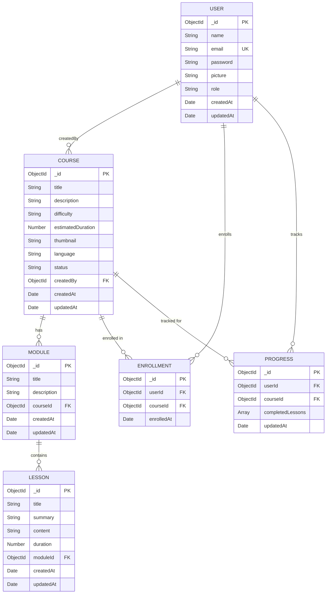

# Database — Text-to-Learn

This document describes the MongoDB data models, schemas, and relationships used in Text-to-Learn.

---

## Overview

Text-to-Learn uses **MongoDB Atlas** as its database, accessed via the **Mongoose** ODM (Object Data Modeling library). The database is organized into six collections:

| Collection | Description |
|---|---|
| `users` | User accounts and authentication data |
| `courses` | AI-generated and manually created courses |
| `modules` | Course modules (sections within a course) |
| `lessons` | Individual lessons within modules |
| `enrollments` | User enrollment records linking users to courses |
| `progress` | Lesson completion progress per user per course |

---

## Entity Relationship Diagram



---

## Schemas

### User (`models/User.js`)

| Field | Type | Required | Constraints | Default |
|---|---|---|---|---|
| `name` | String | ✅ | trimmed | — |
| `email` | String | ✅ | unique, lowercase, trimmed | — |
| `password` | String | ✅ | min 6 chars, `select: false` | — |
| `picture` | String | ❌ | — | `""` |
| `role` | String | ❌ | enum: `student`, `admin` | `"student"` |
| `createdAt` | Date | — | auto (timestamps) | — |
| `updatedAt` | Date | — | auto (timestamps) | — |

**Schema hooks:**
- `pre("save")` — hashes `password` with bcrypt (cost: 12) when modified
- `comparePassword(candidatePassword)` — instance method; returns `bcrypt.compare()` result

```javascript
// Password is NEVER returned in queries unless explicitly selected:
const user = await User.findOne({ email }).select('+password');
```

---

### Course (`models/Course.js`)

| Field | Type | Required | Constraints | Default |
|---|---|---|---|---|
| `title` | String | ✅ | trimmed | — |
| `description` | String | ✅ | trimmed | — |
| `difficulty` | String | ❌ | enum: `Beginner`, `Intermediate`, `Advanced` | `"Beginner"` |
| `estimatedDuration` | Number | ❌ | hours (integer) | `0` |
| `thumbnail` | String | ❌ | URL string | `""` |
| `language` | String | ❌ | — | `"English"` |
| `status` | String | ❌ | enum: `Draft`, `Published` | `"Draft"` |
| `createdBy` | ObjectId | ❌ | ref: `User` | — |
| `createdAt` | Date | — | auto | — |
| `updatedAt` | Date | — | auto | — |

**Notes:**
- AI-generated courses do not set `createdBy` unless the user is authenticated during generation
- Courses start as `"Draft"` and can be promoted to `"Published"`

---

### Module (`models/Module.js`)

| Field | Type | Required | Constraints | Default |
|---|---|---|---|---|
| `title` | String | ✅ | — | — |
| `description` | String | ✅ | — | — |
| `courseId` | ObjectId | ✅ | ref: `Course` | — |
| `createdAt` | Date | — | auto | — |
| `updatedAt` | Date | — | auto | — |

**Notes:**
- Modules are fetched by `courseId` using `Module.find({ courseId })`
- AI generates exactly 5 modules per course

---

### Lesson (`models/Lesson.js`)

| Field | Type | Required | Constraints | Default |
|---|---|---|---|---|
| `title` | String | ✅ | — | — |
| `summary` | String | ✅ | one-sentence summary | — |
| `content` | String | ✅ | 2-3 sentence explanation | — |
| `duration` | Number | ❌ | minutes (integer, 5-20) | `10` |
| `moduleId` | ObjectId | ✅ | ref: `Module` | — |
| `createdAt` | Date | — | auto | — |
| `updatedAt` | Date | — | auto | — |

**Notes:**
- Lessons are fetched by `moduleId` using `Lesson.find({ moduleId })`
- AI generates exactly 5 lessons per module (25 lessons per full course)
- If AI omits lessons, fallback lessons are generated in `aiController.js`

---

### Enrollment (`models/Enrollment.js`)

| Field | Type | Required | Constraints | Default |
|---|---|---|---|---|
| `userId` | ObjectId | ✅ | ref: `User` | — |
| `courseId` | ObjectId | ✅ | ref: `Course` | — |
| `enrolledAt` | Date | — | auto | `Date.now` |

**Notes:**
- Represents a many-to-many relationship between Users and Courses
- Queried via `Enrollment.find({ userId })` to get all user enrollments

---

### Progress (`models/Progress.js`)

| Field | Type | Required | Constraints | Default |
|---|---|---|---|---|
| `userId` | ObjectId | ✅ | ref: `User` | — |
| `courseId` | ObjectId | ✅ | ref: `Course` | — |
| `completedLessons` | [ObjectId] | ❌ | array of Lesson refs | `[]` |
| `updatedAt` | Date | — | auto | — |

**Notes:**
- One document per user per course
- `completedLessons` is an array of lesson `_id` values

---

## Data Access Patterns

| Operation | Query Pattern |
|---|---|
| Get all courses | `Course.find()` or `Course.find({ title: { $regex: q, $options: 'i' } })` |
| Get course by ID | `Course.findById(id)` |
| Get modules for course | `Module.find({ courseId })` |
| Get lessons for module | `Lesson.find({ moduleId })` |
| Get user enrollments | `Enrollment.find({ userId }).populate('courseId')` |
| Get user progress | `Progress.findOne({ userId, courseId })` |
| Mark lesson complete | `Progress.findOneAndUpdate({ userId, courseId }, { $addToSet: { completedLessons: lessonId } })` |
| Search courses | `Course.find({ title: { $regex: query, $options: 'i' } })` |

---

## Connection

**File:** `server/config/db.js`

```javascript
const connectDB = async () => {
  await mongoose.connect(process.env.MONGODB_URI);
  console.log('MongoDB connected');
};
```

Called from `server.js` before starting the HTTP server. If the connection fails, the process exits.

---

## Indexes

MongoDB automatically creates:
- `_id` index on all collections
- Unique index on `users.email` (defined in schema with `unique: true`)

**Recommended additional indexes for production scale:**

```javascript
// For course search performance
courseSchema.index({ title: 'text' });

// For module lookup performance
moduleSchema.index({ courseId: 1 });

// For lesson lookup performance
lessonSchema.index({ moduleId: 1 });

// For enrollment lookup performance
enrollmentSchema.index({ userId: 1, courseId: 1 }, { unique: true });

// For progress lookup performance
progressSchema.index({ userId: 1, courseId: 1 }, { unique: true });
```

---

## MongoDB Atlas Free Tier Limits

| Resource | Limit |
|---|---|
| Storage | 512 MB |
| RAM | Shared |
| Connections | Up to 500 connections |
| Regions | AWS, GCP, Azure (any region) |

The free M0 tier is sufficient for development, testing, and portfolio demonstration. For production at scale, upgrade to M10 or higher.

---

*For API details see [API.md](./API.md) · For deployment see [Deployment.md](./Deployment.md)*
